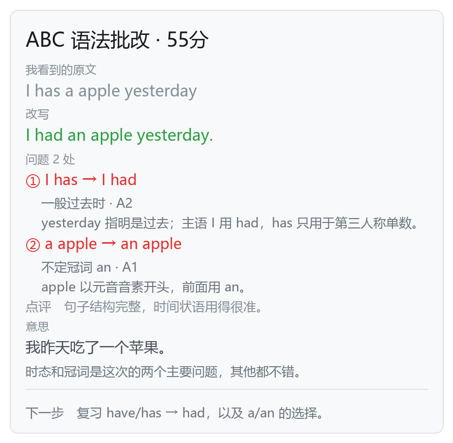

# ai-english-help

Obsidian 插件。在 Excalidraw 画布上框选手写或文本，经 DeepSeek 视觉模型处理，把批改、词源拆解或译文以 Excalidraw 元素的形式写回画布。



## 功能

三个模式，各自独立的提示词与 JSON schema：

| 模式 | 输入 | 输出 |
| --- | --- | --- |
| 🔤 词缀与释义 | 单词，或单词列表（最多 8 个） | 音标、词性、释义、前缀 / 词根 / 后缀拆解、同根词、例句、搭配、记忆线索 |
| 📝 语法批改 | 英文句子 | 转录原文、改写、逐条错误及说明、评分、母语释义、后续学习建议 |
| 🌉 翻译 | 母语或目标语言句子 | 自然 / 直译 / 进阶三版译文、关键句型、生词、常见误用 |

翻译方向在悬浮窗上切换（`⇄`），无需进入设置页。

## 工作原理

单次请求完成识别与讲解，不经过 OCR：

```
框选元素 → 导出为白底 PNG（选区 bbox，scale 2）→ POST /chat/completions
        → JSON（response_format: json_object）→ 排版 → Excalidraw 元素
```

设计上的取舍：

- **不使用 OCR**。手写体缺乏免费且准确的 OCR 方案；云 OCR 只返回文本，仍需二次调用模型，链路更长且成本更高。视觉模型可一次完成转录与讲解。
- **仅处理选区**。整块画布会显著增加 token 消耗，并引入无关上下文。
- **非流式**。先绘制占位卡，收到响应后原地替换。流式需要反复调用 `viewUpdateScene`，收益不足以抵消复杂度。
- **纯文本元素直接读取 `text`**，不导出图片，无识别误差且不产生图像 token。

## 环境要求

- Obsidian 1.5.0 及以上
- [Excalidraw](https://github.com/zsviczian/obsidian-excalidraw-plugin) 插件已安装并启用。PNG 导出使用 `createViewPNG`（2.x），低版本回退至 `createPNG`
- DeepSeek API Key。模型需支持图像输入，默认 `deepseek-flash`
- 仅桌面端（`isDesktopOnly: true`）

## 安装

**手动安装**

1. 从 [Releases](../../releases) 下载 `main.js`、`manifest.json`、`styles.css`
2. 放入 `<vault>/.obsidian/plugins/ai-english-help/`
   （设置 → 第三方插件 → 已安装插件 → 「打开插件文件夹」可直接定位）
3. 设置 → 第三方插件 → 刷新 → 启用 `ai-english-help`

**BRAT**：添加 Beta 插件，填写 `<owner>/ai-english-help`。

安装后在插件设置页填入 API Key（<https://platform.deepseek.com/api_keys>），或设置环境变量 `DEEPSEEK_API_KEY`。

## 使用

1. 在画布上手写或使用文本工具输入
2. 框选目标内容。选区会自动向外扩展 12px 并并入相交的笔迹元素，但需保证框选覆盖完整
3. 通过任一入口触发：

| 入口 | 操作 |
| --- | --- |
| 悬浮窗 | 画布右下角常驻 `🔤 词缀` `📝 批改` `🌉 翻译` `⇄` `⚙`，可拖动，位置持久化 |
| 快捷键 | `Mod+Alt+1` 词缀 / `Mod+Alt+2` 批改 / `Mod+Alt+3` 翻译 / `Mod+Shift+E` 重复上次模式 |
| 元素工具条 | 选中元素后点击 ✨ |
| 命令面板 | 搜索模式名称 |
| 左侧栏 | ⚙ 打开设置 |

4. 首次触发绘制占位卡，响应到达后替换为结果卡（通常 2–6 秒）
5. 同一选区重复触发会更新已有卡片，不追加新卡。卡片通过 `customData.coach` 关联源元素与哈希，用于幂等替换与结果缓存

### 处理文本元素中的单个单词

进入文本编辑状态时，编辑器中的选中文本会直接作为处理输入，不导出图片：

1. 双击进入文本元素，选中目标单词（无选区时取光标所在行）
2. 触发任一模式

同一文本元素重复触发会替换其对应卡片。

### 悬浮窗

- 拖动左侧 `⠿` 调整位置，位置写入设置
- 仅在 Excalidraw 视图显示
- 未显示时：命令面板执行「显示悬浮窗（找不到时点这个）」，输出视图探测结果
- 隐藏：命令面板执行「显示 / 隐藏悬浮窗」，或关闭设置项

## 配置

| 设置 | 默认值 | 说明 |
| --- | --- | --- |
| API Key | 空 | 环境变量 `DEEPSEEK_API_KEY` 优先级更高 |
| Base URL | `https://api.deepseek.com` | 用于中转或代理 |
| 模型 | `deepseek-flash` | 需支持图像输入 |
| 深思模式 | 关 | 启用推理后再作答，延迟增加约 2–3 倍，token 消耗上升 |
| 界面语言 | 跟随母语 | 设置页与悬浮窗的界面语言 |
| 母语 | 中文 | 讲解语言 |
| 要学的语言 | English | 例句与译文语言；不能与母语相同 |
| 我的水平 | A2 | A1 / A2 / B1 / B2，影响讲解深度 |
| 默认模式 | 语法批改 | 「重复上次模式」的初始值 |
| 卡片宽度 | 440 | 360 / 440 / 520 |
| 卡片位置 | 右侧 | 右侧 / 下方 / 左侧 |
| 选区外扩 | 开 | 外扩 12px 并并入相交笔迹 |
| 显示英式音标 | 关 | 追加 UK 音标行 |
| 显示同根词 | 开 | 词缀卡中的词族 |
| 显示打分 | 开 | 语法卡标题中的评分 |
| 发送前确认 | 关 | 发送截图前弹窗确认 |
| 缓存 | 开 | 相同输入命中缓存，不重复请求 |
| 自动归档 | 关 | 每次处理向 `英语学习/Coach/YYYY-MM-DD.md` 追加一行 |
| 画布悬浮窗 | 开 | 画布上常驻模式按钮 |
| 超时 | 45 秒 | 请求超时时间 |

清除缓存：设置页底部「清空缓存」。

## 语言

母语与学习语言决定提示词与卡片内容，界面语言独立可配：

| 配置 | 效果 |
| --- | --- |
| 母语中文 / 学习 English | 讲解与点评使用中文；例句、改写、译文使用英文；按钮 `🔤 词缀` `📝 批改` `🌉 中译英` |
| 母语 English / 学习中文 | 讲解使用英文；例句与译文使用中文；词缀模式转为构词拆解（computer = com + put + -er） |
| 界面语言 | 可与母语分离，例如中文母语搭配英文界面 |

提示词中固定约束：讲解使用母语，目标语言内容保持目标语言原样输出。

## 隐私与数据

- 仅框选范围内的元素被渲染为 PNG 并发送至 `baseUrl` 指定的 DeepSeek 端点，不发送整块画布或笔记文件
- API Key 与响应缓存以明文存储在插件目录的 `data.json`
- 缓存不离开本机，可在设置页清空
- 文本输入同样经过网络请求

## 已知限制

- 手写识别存在误差。卡片首行输出转录原文，用于核对识别结果
- 词源为模型推测。模型标记「词源不确定」的词条应以词典为准；词缀卡末尾附免责行
- 音标与 CJK 字形依赖 Excalidraw 的字体回退，生僻 IPA 符号可能显示为缺字方框
- 仅桌面端
- 依赖 Excalidraw 2.x 的导出 API，低版本回退路径未在新版本上验证

## 性能

2026-10-29，`deepseek-flash`，关闭深思，输入为三张 500–1000px 的手写样图：

| 模式 | 耗时 | token（输入 / 输出） | 识别结果 |
| --- | --- | --- | --- |
| 📝 语法批改 | 3.2 s | 1019 / 549 | 两行全部正确，输出 3 条错误 |
| 🔤 词缀与释义 | 4.7 s | 1061 / 897 | 3 个单词全部正确，词缀拆解完整 |
| 🌉 翻译 | 4.4 s | 941 / 688 | 两行全部正确，输出三版译文与句型 |

- 启用深思后同一输入耗时 8.5 秒，reasoning token 增加 764；简单句子下错误拆分概率上升，默认关闭
- 提示词缓存命中 384–768 token
- 图像 token 按尺寸折算，单图上限 1024

## 故障排查

| 现象 | 原因 | 处理 |
| --- | --- | --- |
| 悬浮窗未出现 | 当前视图不是 Excalidraw，或插件未启用 | 执行命令「显示悬浮窗（找不到时点这个）」查看探测结果 |
| 卡片位置远离选区 | 选区周边无可用空间 | 将卡片位置改为「下方」 |
| HTTP 401 | Key 无效或未启用 | 设置页「测试 Key」 |
| HTTP 402 | 账户余额不足 | 充值后重试 |
| 识别结果错误 | 连笔过多或笔画过小 | 重写后重新框选；单次框选范围不宜过大 |
| 提示未选中内容 | 选区为空且不在 frame 内 | 先框选元素 |

## 开发

无运行时依赖，需要 Node 18 及以上，无需 `npm install`。

```bash
node dev/build.mjs    # 将 src/ 拼接为单文件 main.js，并同步 dist/
node dev/test.mjs     # 单元测试：排版、JSON 修复、哈希、三个模式的 render
node dev/smoke.mjs    # 端到端测试：stub obsidian 与 ExcalidrawAutomate，加载 main.js 跑完整流程
node dev/preview.mjs  # 生成卡片预览（HTML + 排版 JSON）
```

`npm run check` 依次执行 build、test、smoke。修改 `src/` 后需重新构建，并在 Obsidian 中重载插件。

### 目录结构

```
src/
  main.js        插件入口：命令、ribbon、元素工具条、生命周期
  engine.js      单次处理流程：占位卡 → 请求 → 结果卡 → 缓存 / 归档
  ea.js          Excalidraw 交互：EA 实例、选区外扩、PNG 导出（三级降级）
  deepseek.js    请求构造、超时、重试、HTTP 错误映射
  promptkit.js   共用 system 前缀与水平描述
  modes/         word / grammar / translate，各自包含提示词与卡片渲染
  layout.js      纯函数排版：折行、行高、颜色、中文避头尾
  render.js      将排版模型转换为 Excalidraw 元素
  floatbar.js    画布悬浮窗
  settings.js    设置页
  i18n.js        界面语言与内容语言
  util.js        sha1、JSON 修复、HTTP 文案、超时
dev/             构建、单测、冒烟、预览脚本
docs/            设计文档与截图
```

构建不使用打包器：`dev/build.mjs` 按 `ORDER` 数组顺序拼接文件，每个模块包装为返回导出表的 IIFE，`import` 语句被改写为对 `__m["module"]` 的解构。新增源文件需同时更新 `ORDER`。

### 新增模式

1. 在 `src/modes/` 新建 `xxx.js`，导出 `{ id, label, icon, emoji, hotkey, temperature, maxTokens, build(), render() }`
2. `build()` 返回 `{ system, userText }`，提示词需包含 JSON schema 与硬性约束，并以 `JSON_TAIL` 结尾
3. `render(result, settings)` 返回 blocks，类型为 `title / head / label / body / answer / error / orig / small / quote / divider / gap`，可选字段 `color`、`size`、`indent`
4. 在 `src/registry.js` 的 `MODE_ORDER` 中注册，并加入 `dev/build.mjs` 的 `ORDER`

设计取舍记录见 [docs/DESIGN.md](docs/DESIGN.md)。

### 发布

```bash
# 1. 更新 manifest.json、package.json、versions.json 中的版本号
# 2. 构建并提交构建产物
npm run check
git add -A && git commit -m "chore: release 0.1.2" && git push
git tag 0.1.2 && git push origin 0.1.2
```

tag 触发 `.github/workflows/release.yml`：执行构建与测试，校验 tag 与 `manifest.json` 版本一致，上传 `main.js`、`manifest.json`、`styles.css` 至 Release。

## 许可

[MIT](LICENSE)。AI 生成内容仅作参考，不应作为标准答案使用。
